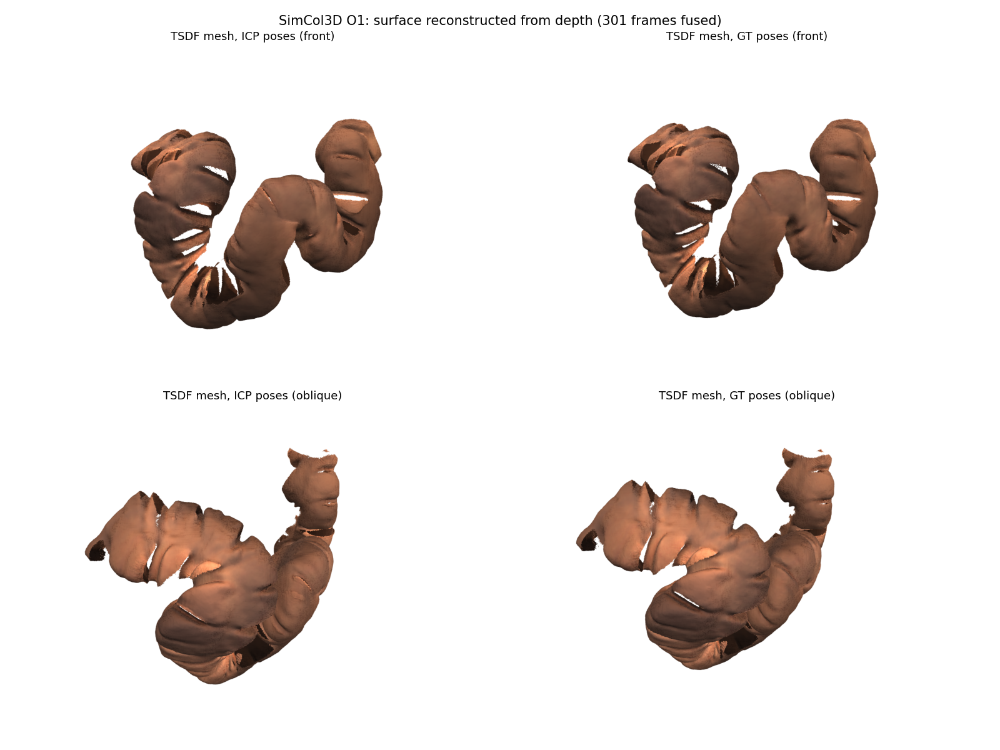
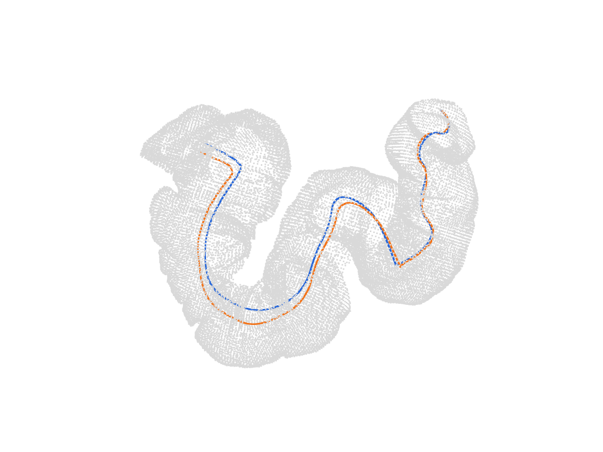
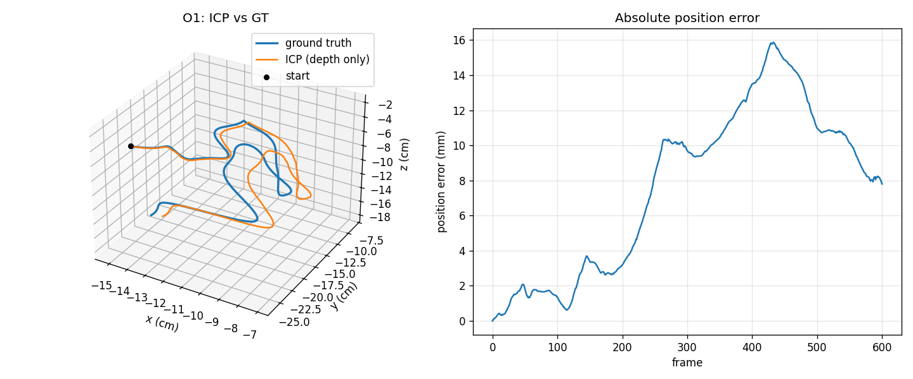
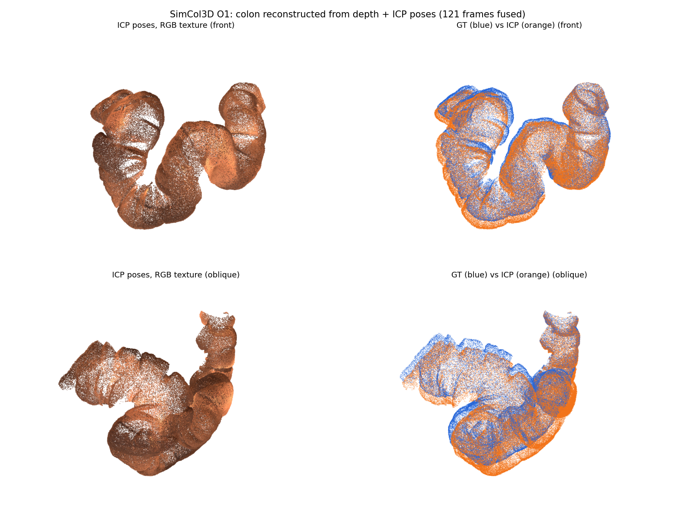

# endo_reconstruct

3D reconstruction of the colon from colonoscopy frames. The idea is simple: if you have an RGB image and a depth map for every frame, you can work out how the camera moved between frames, and once you know that you can stitch everything into one 3D model.

No ground-truth poses are used to build the model. They're only used at the end to check how far off the estimated trajectory is.

Right now the depth maps are the ground-truth ones from the dataset. That's on purpose: it shows how well the pose estimation and fusion work when the depth is perfect. The plan is to replace them with depth predicted by [Depth-Anything-V2](https://github.com/DepthAnything/Depth-Anything-V2), so the whole thing runs from plain RGB video, which is all you get from a real colonoscope.



## Data

I'm using the synthetic part of [SimCol3D](https://doi.org/10.5522/04/24077763.v1) (MICCAI 2022 EndoVis challenge). It has rendered colonoscopy videos with RGB, depth and camera poses. For now only `SyntheticColon_III` is used (3 trajectories, 601 frames each).

A few things about the data that weren't obvious:

- Depth PNGs are 16-bit but really only hold 8 bits of information (every value is a multiple of 256). `value / (256 * 255) * 20` gives depth in cm. That's a resolution of about 0.8 mm.
- Poses come from Unity, which is left-handed. Flipping the y axis on both sides of each pose matrix (`F T F`, with `F = diag(1, -1, 1, 1)`) converts them to a right-handed frame.
- The intrinsics in `cam.txt` are easy to misread. The correct values are fx = fy = 227.6 and cx = cy = 237.5. I checked this by warping depth between frames with the GT poses; the other reading roughly doubles the error.

## How it works

### 1. Depth to 3D points

Each pixel $(u, v)$ with depth $z$ is back-projected into the camera frame:

$$
\mathbf{p} = \begin{bmatrix} (u - c_x)\, z / f_x \\ (v - c_y)\, z / f_y \\ z \end{bmatrix}
$$

### 2. Relative pose with point-to-plane ICP

For each pair of consecutive frames, the cloud from frame $t+1$ (source) is aligned to the cloud from frame $t$ (target). ICP looks for the rigid transform $\mathbf{T} = [\mathbf{R} \mid \mathbf{t}]$ that minimises the point-to-plane error:

$$
E(\mathbf{T}) = \sum_{i} \Big( (\mathbf{R}\,\mathbf{p}_i + \mathbf{t} - \mathbf{q}_i) \cdot \mathbf{n}_i \Big)^2
$$

where $\mathbf{p}_i$ is a source point, $\mathbf{q}_i$ its nearest neighbour in the target, and $\mathbf{n}_i$ the surface normal at $\mathbf{q}_i$. Measuring the error along the normal lets points slide along smooth walls, which converges faster than plain point-to-point ICP and suits the smooth surfaces inside a colon.

The colon barely moves between frames (about 1 mm), so each ICP run starts from the previous frame's motion (a constant-velocity guess).

### 3. Chaining poses

The relative transforms are multiplied together to get each camera's pose in the world frame:

$$
\mathbf{T}^{w}_{t+1} = \mathbf{T}^{w}_{t} \, \mathbf{T}^{t}_{t+1}, \qquad \mathbf{T}^{w}_{0} = \mathbf{I}
$$

Because each step builds on the last, small errors add up over time (drift).

### 4. Fusion

Every frame's points are moved into the world frame with its estimated pose, $\mathbf{x} = \mathbf{R}^{w}_{t}\,\mathbf{p} + \mathbf{t}^{w}_{t}$, and merged. There are two outputs:

- **Point cloud:** all the points merged and thinned to one per 0.5 mm. No smoothing.
- **TSDF mesh:** depth maps fused into a truncated signed distance volume (0.5 mm cells), then turned into a surface with marching cubes. Averaging over many frames smooths out noise and small pose errors.

### 5. Evaluation

The estimated trajectory is compared to GT using the absolute trajectory error on camera positions:

$$
\text{ATE} = \sqrt{\frac{1}{N} \sum_{t=1}^{N} \left\lVert \mathbf{t}^{\text{est}}_t - \mathbf{t}^{\text{gt}}_t \right\rVert^2}
$$

## Results

Pose estimation from GT depth on Colon III:

| Trajectory | Path length | ATE RMSE | Final error | Drift |
|---|---|---|---|---|
| O1 | 53.8 cm | 9.0 mm | 7.8 mm | 1.4% |
| O2 | 53.9 cm | 10.7 mm | 20.7 mm | 3.8% |
| O3 | 54.5 cm | 7.6 mm | 10.6 mm | 1.9% |

The estimated trajectory follows the GT one closely. Most of the error comes from small rotation errors (about 0.15° per frame) adding up.





### Without smoothing (point cloud)

Every 5th frame back-projected and merged. The overlay on the right shows the GT-pose cloud in blue and the ICP-pose cloud in orange. Where the poses have drifted, the walls look doubled.



### With smoothing (TSDF mesh)

Same data fused into a TSDF volume. The surface is much cleaner, and the ICP and GT versions are hard to tell apart. The holes are real: they're the backs of folds that the camera never sees.


## How to run

Set up the environment (Python 3.10+):

```bash
python3 -m venv .venv
.venv/bin/pip install torch --index-url https://download.pytorch.org/whl/cu126
.venv/bin/pip install -e '.[dev]'
```

Download the data (Colon III is about 0.6 GB; `I` and `II` are about 5 GB each):

```bash
scripts/download_simcol.sh misc III
```

Estimate poses and build the reconstruction for one trajectory:

```bash
.venv/bin/python scripts/estimate_poses.py --trajectory O1
.venv/bin/python scripts/reconstruct.py --trajectory O1
```

Results end up in `outputs/poses/` and `outputs/reconstruction/`. The `.ply` files open in MeshLab or Open3D.

If you have ROS sourced, run with `env -u PYTHONPATH` in front, otherwise ROS packages can shadow the ones in the venv.

## Future plan

The main next step is to stop using GT depth and predict it from the RGB frames with Depth-Anything-V2 instead. The pipeline stays the same (depth → ICP → fusion); only the source of the depth maps changes. The results above then become the upper bound to compare against.

This won't be a drop-in swap:

- Depth-Anything's relative models predict depth only up to an unknown scale and offset, and the metric models were trained on indoor and driving scenes, not the inside of a colon. The predictions will need scale alignment, and probably fine-tuning on SimCol.
- Predicted depth is noisier than rendered depth, so I expect more drift. Frame-to-model tracking or loop closure may be needed to keep it under control.

## License

Code is MIT. SimCol3D is CC BY-NC-SA 4.0 and is not included in this repo.
